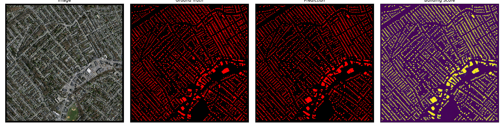
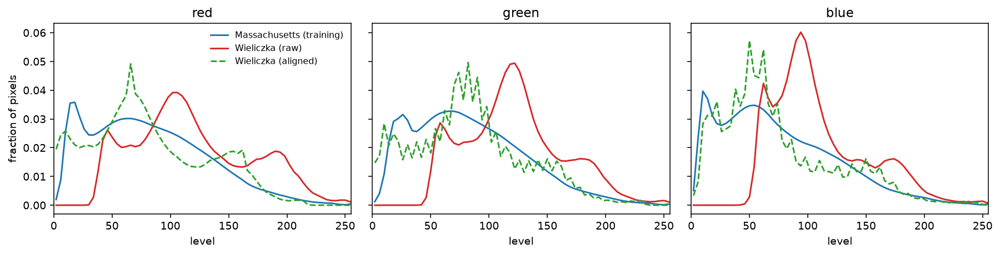
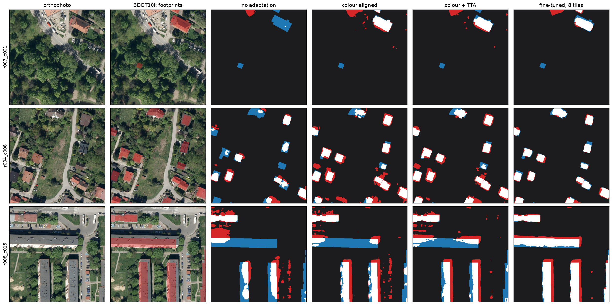
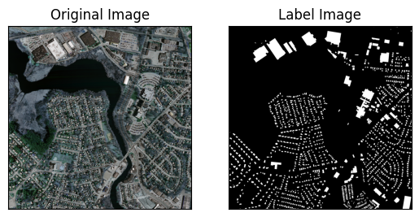

# building-segmentation

U-Net semantic segmentation of buildings in aerial imagery. Trained on the
[Massachusetts Buildings dataset](https://www.cs.toronto.edu/~vmnih/data/),
then evaluated unchanged on Polish orthophotos of Wieliczka to measure the
domain gap - and to find out what actually closes it.



## Results

151 Massachusetts tiles of 1500×1500 px, split 137/4/10.

| | mean IoU | building IoU | precision | recall |
|---|---|---|---|---|
| 12 epochs | 0.545 | 0.382 | - | - |
| 100 epochs | **0.776** | **0.643** | 0.766 | 0.800 |

## The domain gap

Same checkpoint, nothing retrained, on 128 held-out Wieliczka tiles
(Geoportal orthophotos at 25 cm, BDOT10k building polygons as labels):

| | mean IoU | building IoU | precision | recall |
|---|---|---|---|---|
| Massachusetts test | 0.776 | **0.643** | 0.766 | 0.800 |
| Wieliczka test, unadapted | 0.639 | **0.375** | 0.544 | 0.546 |

−0.268 building IoU, 42% of it gone. Different cameras, different light,
different roofs. The Massachusetts number was re-measured through the same code
path first and reproduced exactly, so the drop is the domain and not the
plumbing.

## Closing it without Polish labels

`adapt.py` aligns the target radiometry to the *training* set's statistics and
averages predictions over the eight symmetries of the tile. The reference
statistics come from the training split and never from the tiles being scored,
so nothing here peeks at the answer.

| Δ building IoU on the same 128 tiles | |
|---|---|
| colour (moments) + TTA | **+0.143** |
| colour, moments | +0.115 |
| colour, histogram | +0.078 |
| colour, histogram, no-data padding left in the reference | +0.050 |
| TTA alone | +0.029 |



The Polish orthophotos are brighter and narrower in every channel; alignment
pulls them back onto the training distribution. The spike at the dark end of the
Massachusetts curve is the no-data padding, which is exactly why it has to be
excluded from the reference.

Two things worth taking away. **Colour alignment buys recall**: 0.546 → 0.764.
What is left after it is a precision problem, and TTA is what chips at that.
And **what the reference is measured over matters as much as which method reads
it** - 8.5% of the Massachusetts training pixels are no-data padding, and
leaving that black in the reference costs a third of what histogram matching is
worth. Hence `--exclude-colour`.

## Closing it with a handful of Polish labels

`train.py --init-from --train-limit N` fine-tunes the Massachusetts checkpoint
on N labelled tiles under a fixed step budget. Draws are nested, so N=8 contains
N=4 and the curve measures what each extra tile buys.

| labelled tiles | Δ building IoU |
|---|---|
| 1 | **+0.179** |
| 2 | +0.184 |
| 4 | +0.204 |
| 8 | **+0.245** |
| 16 | +0.238 |
| 32 | +0.239 |
| 96 | +0.282 |

**One labelled 128 m tile beats every label-free method put together**
(+0.179 against +0.143), and eight tiles recover 91% of the gap. That is the
result worth carrying to the next dataset: before spending a week on clever
unsupervised alignment, spend an afternoon labelling. Draw-to-draw variance is
±0.035 IoU at 1-4 tiles and ±0.007 by 16, so the single-tile number is a range,
not a point.

Fine-tuning also forgets: the 96-tile model scores 0.109 building IoU back on
Massachusetts. Adaptation here means moving the model, not widening it.



Hits white, false positives red, misses blue, across no adaptation → colour →
colour + TTA → fine-tuned.

## What is not established

One area of interest, one town, one season, one architecture. Fine-tuning
hyperparameters untuned. The `colour + TTA` row picked its colour method by
looking at the test split, so it is mildly optimistic; the single-method rows
are not. A wider sweep of label-free methods was run; the three colour variants
and TTA kept here are the ones that came out on top, and only they are
reproduced in this repository.

## Data

Massachusetts Buildings (tiles + RGB-coded masks) under `data/massachusetts-buildings/`:

```
├── metadata.csv            # image/mask paths per split, or:
├── train/ train_labels/    # pre-split directory tree
├── val/   val_labels/
├── test/  test_labels/
└── label_class_dict.csv    # name,r,g,b palette
```



Masks code buildings **red**, not white - hence the palette file.

Both datasets are public and neither is redistributed here; `data/` is
gitignored. Massachusetts Buildings is Mnih's public research dataset. The Polish
side is Polish open government data from [GUGiK](https://www.geoportal.gov.pl/):
orthophotos from the national geoportal and building polygons from BDOT10k, both
free to download and use without restriction. They arrive as GeoTIFF and were
exported to plain PNG tiles in the layout above, so no GIS library is needed
here.

The encoder starts from ImageNet-pretrained weights, whose terms are
research-use; swap `encoder_weights=None` if that matters for your use.

## Usage

```bash
pip install -r requirements.txt

python train.py                        # 12 epochs by default, --epochs 100 for the real run
python predict.py --checkpoint runs/default/best_model.pth --split test
```

Cross-dataset, label-free:

```bash
python adapt.py data/massachusetts-buildings --split train \
    --exclude-colour 0 0 0 -o stats/massachusetts.json
python adapt.py data/wieliczka --split train -o stats/wieliczka.json

python predict.py --checkpoint runs/default/best_model.pth --data-root data/wieliczka \
    --colour moments --reference-stats stats/massachusetts.json \
    --dataset-stats stats/wieliczka.json --tta --no-panels
```

Cross-dataset, few-shot:

```bash
python train.py --data-root data/wieliczka --init-from runs/default/best_model.pth \
    --train-limit 8 --epochs 34 --out runs/finetune-n8
python predict.py --checkpoint runs/finetune-n8/best_model.pth \
    --data-root data/wieliczka --split test --no-panels
```

`predict.py` writes `metrics.json` and side-by-side panels (input / ground truth
/ prediction) into `outputs/panels/`.

`notebooks/demo_segmentation_basics.ipynb` downloads a single real tile and
works through palettes, mask decoding, augmentation and IoU on it - the quickest
way in. `notebooks/unet_buildings.ipynb` then walks the full dataset and a short
training run.

## Files

| file | what it does |
|---|---|
| `data.py` | class palettes, mask decoding, pairing images with masks, splits |
| `train.py` | U-Net training and fine-tuning, Dice loss, IoU per epoch |
| `predict.py` | scores a split, with optional colour alignment and TTA |
| `adapt.py` | dataset radiometry statistics, three colour methods, TTA |

## A guided tour of the code

[`docs/walkthrough.md`](docs/walkthrough.md) explains the whole repository line by
line, assuming no prior programming experience.
